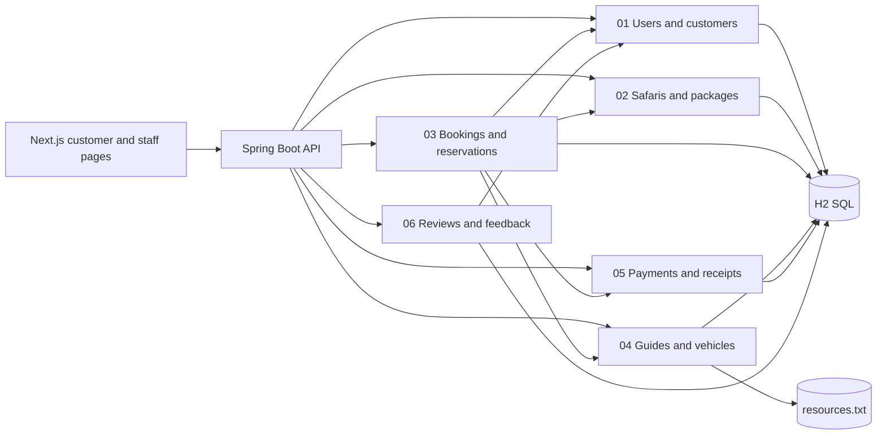

<div align="center">

# WildTrail

### Safari Booking System

Plan a Sri Lankan wildlife safari, manage reservations, and run the supporting staff workflows from one application.


**[Get started](#get-started)** · **[Features](#features)** · **[Team](#team-and-responsibilities)** · **[Quality checks](#quality-checks)** · **[Documentation](#documentation)**

</div>


## At a glance

| Layer | Technology | Role |
|---|---|---|
| Website | Next.js 16, React 19, TypeScript | Customer pages, booking flow, and staff console |
| API | Java 17, Spring Boot 3.5 | Business rules, authentication, and CRUD endpoints |
| Data | Persistent H2 SQL; file storage for guides | Local records and `resources.txt` guide management |
| Verification | JUnit, ESLint, TypeScript, Playwright | Backend, build, and browser checks |

The six Java business modules live under `backend/src/main/java/com/wildtrail/modules/`. The website calls the Java API through the Next.js `/api` proxy. See [the class diagram](docs/CLASS_DIAGRAM.md) and [backend configuration](backend/README.md) for more detail.

## Get started

**Requirements:** Windows PowerShell, JDK 17, Node.js 22+, and an internet connection for the first Maven/npm dependency download. Open two PowerShell terminals in the project root. Set `JAVA_HOME` to your installed JDK 17 path if it differs from the example.

**Terminal 1 — configure and start the API**

```powershell
$env:JAVA_HOME = 'C:\Program Files\Java\jdk-17'
powershell -ExecutionPolicy Bypass -File scripts\setup.ps1 -AdminEmail 'your-email@example.com'
powershell -ExecutionPolicy Bypass -File scripts\start-backend.ps1 -Build
```

**Terminal 2 — start the website**

```powershell
powershell -ExecutionPolicy Bypass -File scripts\start-frontend.ps1 -Production
```

Open **[the local website](http://localhost:3000/client/home)**. Customers and staff use the same **[Sign in](http://localhost:3000/client/login)** page; a staff account is routed to the admin console. The API listens on port `8080` and the website on port `3000`.

On first setup, the script generates a local administrator password in **`.local/admin-access.txt`**. Keep that file private. Existing `.local/config.json` and accounts are preserved on later runs; re-running setup does not reset a password. Every teammate should initialize their own local checkout with their own administrator email.

## Features

| Area | Implemented flow |
|---|---|
| Accounts | Customer registration, sign in/out, profile and password updates, protected staff routes, and administrator accounts that also support personal bookings and reviews |
| Safaris | Searchable destinations and packages, package management, and vehicle catalogue |
| Reservations | Multi-step booking, server-calculated pricing, availability checks, pickup places, vehicle numbers, booking history, and eligible changes/cancellations with 24-hour notice |
| Resources | Guide CRUD in `resources.txt`, vehicle registration and private owner details with fleet CRUD, schedules, and guide assignment |
| Payments | Cash-on-arrival tracking, a **campus-only card demonstration**, staff-recorded collection/refunds, payment summaries with actual collection dates, and printable receipts |
| Feedback | Immediately published customer/admin reviews, deletion and administrator replies; removable fictional samples; contact form and staff inbox |
| Reports | Save/read text snapshots for the six business areas |

The card demonstration keeps the payment **pending** and accepts no card number, expiry, CVV, or holder details. Real online payment, outbound email, verified park availability, and a production business identity are outside this project.

See [account, booking and review behavior](docs/ACCOUNT_BOOKING_REVIEWS.md) for personal administrator bookings, pickup places, vehicle numbers, payment dates and public review replies.

## Team and responsibilities

Group **26-MTR-Y1S2-WD-009** follows the six-component Safari Booking System workload distribution.

| Member | Student | Name | Module |
|:---:|---|---|---|
| 01 | IT26100894 | Mekhala B.G.R.S | [Users and customers](team/IT26100894-Mekhala-BGRS/README.md) |
| 02 | IT26100895 | Mihiran S.P.D | [Safaris and packages](team/IT26100895-Mihiran-SPD/README.md) |
| 03 | IT26100896 | Nayanajith W.R.S.C | [Bookings and reservations](team/IT26100896-Nayanajith-WRSC/README.md) |
| 04 | IT26100899 | Senevirathna M.K.K.T | [Guides and vehicles](team/IT26100899-Senevirathna-MKKT/README.md) |
| 05 | IT26100900 | Lakshani W.G.C | [Payments and receipts](team/IT26100900-Lakshani-WGC/README.md) |
| 06 | IT26100901 | Gamage C.I.P | [Reviews and feedback](team/IT26100901-Gamage-CIP/README.md) |

Select a module in the table, then click a file path in its guide to open the exact Java or UI source file. Each guide also covers shared code and a viva demonstration. The integrated application stays in **one repository**. Individual ZIPs in the sibling `Team-Member-Handoff` folder provide module reference copies. See the [workload distribution](docs/WORKLOAD_DISTRIBUTION.md) and [GitHub Desktop workflow](docs/GITHUB_WORKFLOW.md).

## One system, six connected components

The modules form one booking journey. A visitor discovers a safari, a customer reserves a package and vehicle, staff assign resources and record payment, and the customer can leave a review. The same Java API validates access and coordinates records across the six components.



| Owner | Component and core Java classes | Customer/staff pages and shared UI |
|---|---|---|
| **01 · Mekhala · IT26100894** | [User](backend/src/main/java/com/wildtrail/modules/users/User.java), [Customer](backend/src/main/java/com/wildtrail/modules/users/Customer.java), [Admin](backend/src/main/java/com/wildtrail/modules/users/Admin.java), [AuthService](backend/src/main/java/com/wildtrail/modules/users/AuthService.java), [CustomerService](backend/src/main/java/com/wildtrail/modules/users/CustomerService.java) | [Register](src/app/client/register/page.tsx), [login](src/app/client/login/page.tsx), [profile](src/app/client/profile/page.tsx), [staff accounts](src/app/admin/%28panel%29/accounts/page.tsx) |
| **02 · Mihiran · IT26100895** | [SafariPackage](backend/src/main/java/com/wildtrail/modules/safaris/SafariPackage.java), [PackageService](backend/src/main/java/com/wildtrail/modules/safaris/PackageService.java), [PackageController](backend/src/main/java/com/wildtrail/modules/safaris/PackageController.java) | [Safaris](src/app/client/safaris/page.tsx), [packages](src/app/client/packages/page.tsx), [destinations](src/app/client/destinations/page.tsx), [staff packages](src/app/admin/%28panel%29/packages/page.tsx) |
| **03 · Nayanajith · IT26100896** | [Booking](backend/src/main/java/com/wildtrail/modules/bookings/Booking.java), [BookingService](backend/src/main/java/com/wildtrail/modules/bookings/BookingService.java), [BookingController](backend/src/main/java/com/wildtrail/modules/bookings/BookingController.java), [JdbcBookingRepository](backend/src/main/java/com/wildtrail/modules/bookings/JdbcBookingRepository.java) | [Booking wizard](src/components/client/BookingWizard.tsx), [my bookings](src/app/client/my-bookings/page.tsx), [staff bookings](src/app/admin/%28panel%29/bookings/page.tsx) |
| **04 · Senevirathna · IT26100899** | [Guide](backend/src/main/java/com/wildtrail/modules/resources/Guide.java), [Vehicle](backend/src/main/java/com/wildtrail/modules/resources/Vehicle.java), [FileGuideRepository](backend/src/main/java/com/wildtrail/modules/resources/FileGuideRepository.java), [VehicleService](backend/src/main/java/com/wildtrail/modules/resources/VehicleService.java) | [Vehicles](src/app/client/vehicles/page.tsx), [staff guides](src/app/admin/%28panel%29/guides/page.tsx), [staff vehicles](src/app/admin/%28panel%29/vehicles/page.tsx) |
| **05 · Lakshani · IT26100900** | [Payment](backend/src/main/java/com/wildtrail/modules/payments/Payment.java), [PaymentProcessor](backend/src/main/java/com/wildtrail/modules/payments/PaymentProcessor.java), [PaymentService](backend/src/main/java/com/wildtrail/modules/payments/PaymentService.java), [ReceiptController](backend/src/main/java/com/wildtrail/modules/payments/ReceiptController.java) | [Booking payment step](src/components/client/BookingWizard.tsx), [my payments](src/app/client/payments/page.tsx), [payment summary](src/components/client/PaymentSummary.tsx), [receipt](src/app/client/receipts/%5Bid%5D/page.tsx), [staff payments](src/app/admin/%28panel%29/payments/page.tsx) |
| **06 · Gamage · IT26100901** | [Review](backend/src/main/java/com/wildtrail/modules/reviews/Review.java), [VerifiedReview](backend/src/main/java/com/wildtrail/modules/reviews/VerifiedReview.java), [ReviewService](backend/src/main/java/com/wildtrail/modules/reviews/ReviewService.java), [ReviewController](backend/src/main/java/com/wildtrail/modules/reviews/ReviewController.java) | [Reviews](src/app/client/reviews/page.tsx), [my reviews](src/app/client/my-reviews/page.tsx), [contact](src/app/client/contact/page.tsx), [review management](src/app/admin/%28panel%29/reviews/page.tsx), [staff replies](src/components/client/ReviewReplies.tsx) |

The [complete project map](docs/SYSTEM_MAP.md) links Java classes, web routes, shared components, data stores, and cross-module dependencies. The [integrated class diagram](docs/CLASS_DIAGRAM.md) shows how the six components work together.

## Project layout

```text
WildTrail-Public-Source/
├── README.md                       Start here: setup, architecture, team, and links
├── package.json                    Next.js scripts and dependencies
├── next.config.ts                  /api rewrite to the Java backend
├── src/
│   ├── app/client/                 Website pages: discovery, booking, account, payment history, reviews
│   ├── app/admin/(panel)/          Staff pages: bookings, catalogue, payments, reports
│   ├── components/client/          Shared customer UI and booking wizard
│   ├── components/admin/           Shared administration UI
│   ├── lib/                        API client, session helpers, and site content
│   └── types/                      Shared TypeScript domain contracts
├── backend/
│   ├── pom.xml                     Java 17 / Spring Boot Maven build
│   └── src/
│       ├── main/java/com/wildtrail/
│       │   ├── modules/users/       01: identity and customer records
│       │   ├── modules/safaris/     02: safari packages and catalogue
│       │   ├── modules/bookings/    03: reservations and availability
│       │   ├── modules/resources/   04: guides and vehicles
│       │   ├── modules/payments/    05: payment state and receipts
│       │   ├── modules/reviews/     06: reviews and replies
│       │   ├── config/              Application configuration and startup
│       │   ├── controller/          Shared HTTP endpoints
│       │   ├── repository/          Shared persistence support
│       │   ├── service/             Shared application services
│       │   ├── exception/           API error responses
│       │   ├── util/                Reusable backend helpers
│       │   └── security/            Session and access checks
│       ├── main/resources/          Application properties and catalogue seeds
│       └── test/java/com/wildtrail/ Java domain and API tests
├── database/                       SQL schema and sample catalogue data
├── scripts/                        Local setup, startup, and optional sharing
├── qa/                             Repeatable browser QA scripts
├── docs/                           Class map, reports, QA, and viva notes
└── team/                           Six member-specific source and viva guides
```

Open the [complete project map](docs/SYSTEM_MAP.md) to jump from each component to its individual Java classes and website pages. The [integrated class diagram](docs/CLASS_DIAGRAM.md) connects the components in one view.

The persistent local H2 database is stored at `backend/data/wildtrail.mv.db`. Do not run two API processes against the same H2 file. SQL is authoritative for most records; guide CRUD uses a real text file. Text reports are snapshots, not replacement databases. PostgreSQL configuration is available, but this handoff was verified with H2.

## Quality checks

Run these from the project root after dependencies are available:

```powershell
backend\mvnw.cmd -f backend\pom.xml test
npm.cmd ci
npm.cmd run typecheck
npm.cmd run lint
npm.cmd run build
```

Browser QA creates sample users and bookings. Run it only with a **disposable local database** and follow the guard instructions in the [QA report](docs/QA_REPORT.md):

```powershell
npx.cmd playwright install chromium
$env:QA_ALLOW_MUTATIONS = '1'
npm.cmd run qa:browser
```

Each member should understand their module, test their changes, and commit from their own GitHub account. The [viva guide](docs/VIVA_GUIDE.md) explains the implementation and its limits.

## Documentation

| Guide | Purpose |
|---|---|
| [Workload distribution](docs/WORKLOAD_DISTRIBUTION.md) | Six modules and cross-module ownership |
| [GitHub workflow](docs/GITHUB_WORKFLOW.md) | Clone, branch, commit, push, and pull-request steps |
| [Viva guide](docs/VIVA_GUIDE.md) | Demonstration flow and OOP explanations |
| [QA report](docs/QA_REPORT.md) | Test scope, evidence, and limits |
| [Final report](docs/FINAL_REPORT.md) | Project design, implementation, validation, and individual Git evidence |
| [Class diagram](docs/CLASS_DIAGRAM.md) | Domain relationships |
| [Complete project map](docs/SYSTEM_MAP.md) | Every Java package, website area, owner, and cross-module link |
| [Accounts, payments and reviews](docs/ACCOUNT_BOOKING_REVIEWS.md) | Website/admin access, pickup and payment details, private vehicle ownership, review publication and replies |
| [Technical overview](docs/TECHNICAL_OVERVIEW.md) | Architecture, persistence, business rules, and scope |
| [Local public sharing](docs/PUBLIC_SHARING.md) | Optional temporary Cloudflare Quick Tunnel instructions |

> [!IMPORTANT]
> Keep `.local/`, environment files, databases, build output, logs, and credentials out of Git. A private repository limits visibility but does not replace careful handling of local secrets and customer data.
