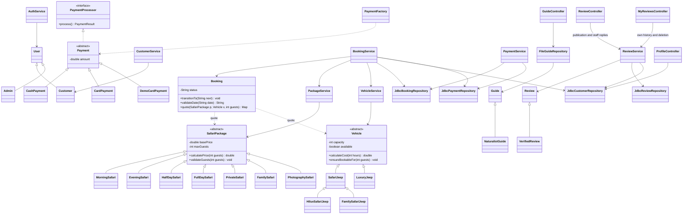

# One integrated class diagram

This view connects the six business components in one system. It shows the principal implemented model inheritance and service/repository dependencies; the [complete project map](SYSTEM_MAP.md) links every Java class and website page. The `BookingService` dependencies show why package, resource, and payment changes need cross-module review.

The diagram can be rendered by Mermaid-capable Markdown viewers. Customer ownership, booking/payment records, and guide assignments are linked through the repositories and SQL schema; guide details are handled by `FileGuideRepository` in `resources.txt`. Data ownership is explained in [the technical overview](TECHNICAL_OVERVIEW.md).

The domain diagram focuses on Java behavior rather than every SQL field. Booking persistence additionally stores pickup place and the original safari/vehicle price split. Vehicle persistence stores registration and private owner metadata; administrator-only response mapping keeps owner contact/address/ID out of public vehicle data. Payment history joins the booking with its recorded collection date. Review replies are stored in SQL and exposed through `ReviewService`; these additions do not introduce separate domain subclasses. See [current feature behavior and source links](ACCOUNT_BOOKING_REVIEWS.md).
